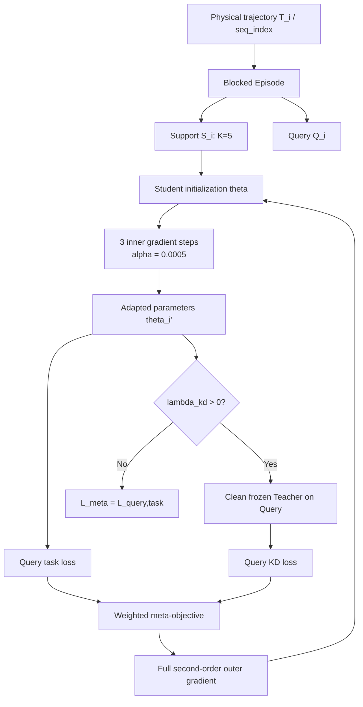

# MAML Architecture and Training Flow

This document describes the **current implemented architecture and optimization flow** so it can be reviewed before any paper-specific modification.

## 1. Base sensing model

### Lightweight Student
```text
Camera sequence --> lightweight image CNN --\
                                         +--> feature fusion --> single-layer GRU --> beam classifier
Radar sequence  --> lightweight radar CNN --/
```

### Reference Teacher
```text
Camera sequence --> Image CNN --\
                              +--> feature fusion --> 2-layer GRU --> Multi-Head Attention --> beam classifier
Radar sequence  --> Radar CNN --/
```

Reference complexity used in the project:
- Teacher: ~2.95M parameters, ~179.25M FLOPs.
- Student: ~0.106M parameters, ~42.72M FLOPs.

## 2. Meta-learning task
```text
T_i = one seq_index = one physical trajectory/run
```

Clean split:
- 86 Meta-Train tasks.
- 21 Meta-Val tasks.
- 28 protected Meta-Test tasks.

## 3. Leakage-safe episode
Each sample spans:
- W = 8 observation positions.
- J = 3 future target positions.

Therefore:
```text
temporal span = 8 + 3 = 11 positions
```

Final Support/Query episodes enforce:
```text
minimum temporal distance = 11
```

## 4. Inner loop: task-specific adaptation
For task T_i:
```text
K = 5
inner_lr = 0.0005
inner_steps = 3
```

Update:
```text
theta_i' = theta - alpha * grad_theta L_support(theta)
alpha = 0.0005
```

The current MAML-KD formulation uses task loss for Support adaptation. Teacher guidance is added to the Query meta-objective, not to the Support update.

## 5. Query evaluation
```text
Support S_i --> adapt --> theta_i' --> evaluate on temporally separated Query Q_i
```

The Query set tests whether Support-based adaptation generalizes within the same physical trajectory.

## 6. Full MAML outer loop
The Query loss updates the original initialization theta. The outer gradient differentiates through the inner update, so the implementation is **full second-order MAML**.

Implementation consequence:
- higher-order graph construction is required;
- cuDNN GRU double-backward was incompatible in this path;
- cuDNN was disabled for MAML while CUDA/GPU execution remained active.

## 7. MAML-only objective
For `lambda_kd = 0`:
```text
L_meta = L_query,task
```

## 8. MAML-KD / Meta-KD objective
For Teacher guidance:
```text
L_meta = (1 - lambda_kd) * L_query,task
       + lambda_kd       * L_query,KD
```

Tested:
```text
lambda_kd = 0     -> MAML-only
lambda_kd = 0.05  -> light Teacher guidance
lambda_kd = 0.10  -> stronger Teacher guidance
```

For every `lambda_kd > 0` run, the clean frozen Teacher is used explicitly.

## 9. Initialization variants

### MAML-only / MAML-KD
Start from the **Clean No-KD Student**.

### KD-initialized MAML
Start from the **Clean KD Student**, then run Full MAML with:
```text
lambda_kd = 0
```
This isolates KD as an initialization from KD as a continuous meta-loss.

## 10. Frozen settings
```text
K support       = 5
temporal gap    = 11
inner_lr        = 0.0005
inner_steps     = 3
meta_lr         = 1e-5
meta_epochs     = 5 max
lambda_kd       = 0 / 0.05 / 0.10
primary metric  = Macro Top-1
secondary       = Micro Top-1
```

## 11. Architecture diagram


## 12. What the current results imply
- KD-init MAML: strongest numerical starting/final Macro on protected Meta-Test, but negative adaptation.
- MAML-KD `lambda_kd=0.05`: strongest positive test-time adaptation, but weaker absolute starting/final Macro.
- MAML-only: highest final Meta-Val, but negative adaptation on protected Meta-Test.

This is the current **representation–adaptability trade-off**.

## 13. Review questions before the next experiment
These are open review points, not claims that the architecture must change:
1. Should inner-loop adaptation update all Student parameters, or only selected layers?
2. Should the inner learning rate remain fixed, or become layer-wise / learnable?
3. Should KD remain only in the Query meta-objective?
4. Should KD initialization be combined with a representation-preserving constraint during inner adaptation?
5. Should adaptation be task-aware / confidence-gated rather than applied blindly to every trajectory?
6. What fresh held-out scenario should be reserved for the next proposed method, since the current protected Meta-Test has already been opened?
